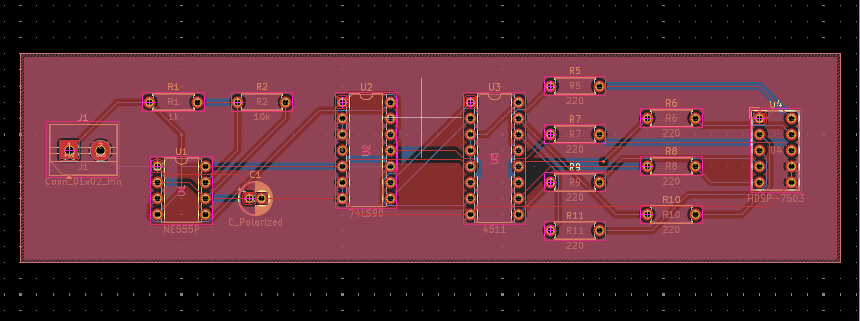

# BCD Decade Counter PCB

A breadboard circuit I turned into a PCB to get more comfortable with digital electronics and KiCad.


This started with a pretty simple goal: **make a 7-segment display count from 0 to 9 without using a microcontroller.** I first wired the circuit on a breadboard, checked that the counter worked, and then tried to fit the same idea onto a board I could design myself.

The interesting part wasn't the counting. It was figuring out how the clock, counter, decoder, resistors, and display all needed to connect, then translating that into an actual PCB layout.

## How it works

```text
NE555 timer (clock)
        |
        v
74LS90 decade counter (0–9)
        |
        v
4511 BCD-to-7-segment decoder
        |
        v
7-segment display (HDSP-7503)
```

The **NE555** provides the pulses. The **74LS90** counts them through the ten decimal states. The **4511** translates the BCD output into signals for the display. Seven **220 Ω resistors** limit current through the display segments.

The KiCad schematic also includes a **1 kΩ resistor, a 10 kΩ resistor, a polarized capacitor, and a two-pin power connection**. I used an external **5 V breadboard power module** during prototyping rather than designing a regulator onto this board.

## From breadboard to PCB

| PCB layout | Schematic |
| :---: | :---: |
|  |  |

After getting the breadboard circuit running, I redrew it in KiCad, assigned the through-hole footprints, and routed the board. This was a useful introduction to how much more deliberate you have to be once your wires become copper traces.

The schematic and board files are in [KiCad/](KiCad/). Open `BCD Decade Counter.kicad_pro` in KiCad to see or edit the actual design.

## Where it stands

- **Breadboard:** built and tested.
- **Schematic and PCB layout:** completed.
- **ERC/DRC:** passed during my design work.
- **Fabricated and assembled PCB:** **not yet tested**; fabrication was still pending when I documented the project.

I'm leaving the project as it is for now. It was a small circuit, but it was an important step in going from *connecting components* to designing the board those components sit on.

Built by **Adhyayan Tiwari** · [MIT License](LICENSE)
